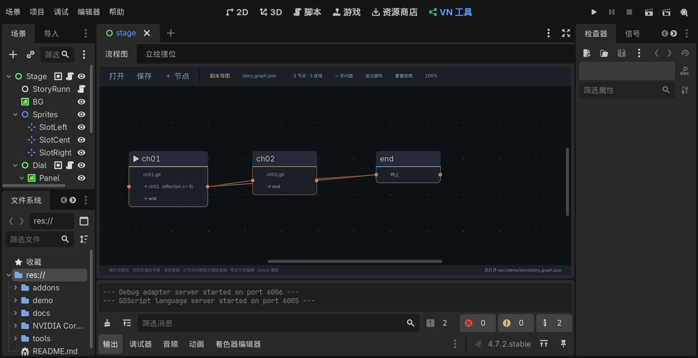

# 流程图面板

启用插件后顶部主屏幕多出「VN 工具」，里面两个标签：**流程图**、**立绘摆位**。本文只讲流程图，立绘摆位见 [STAGE.md](STAGE.md)。

这个标签**只做一件事：编辑一份 `story_graph.json`**。它不定义资源格式、不接管运行时、不参与游戏节点结构。关掉面板、甚至删掉整个 `addons/vn/`，图和游戏都照常跑。

## 版面



（画布吃掉顶栏与底栏之间的全部高度——这里没有一行手算布局。）

```
┌──────────────────────────────────────────────────────────┐
│ 打开  保存  ＋节点 │ 剧本导图  ch01.json  3节点·3连线  ✓无问题  适应画布  重置视图  100% │  ← 顶栏（固定 52px）
├──────────────────────────────────────────────────────────┤
│                                                          │
│                    GraphEdit 画布                        │  ← 抢剩余高度
│                                                          │
├──────────────────────────────────────────────────────────┤
│ 拖节点移动 · 空白处拖动平移 · 滚轮缩放 …        已打开 xxx │  ← 底栏（固定 26px，左侧提示 / 右侧状态）
└──────────────────────────────────────────────────────────┘
```

尺寸全部交给容器：本节点 `SIZE_EXPAND_FILL`，内部 `VBoxContainer` 排队（顶栏固定 / 画布抢剩余 / 底栏固定）。不写任何 `position/size` 手算，所以拖控制台分隔条、切标签、改窗口大小都不会塌。

顶栏按钮多，外面套了一层横向 `ScrollContainer`。窗口极窄时它是横向滚动，不会把整个面板撑宽。

---

## 顶栏按钮

| 按钮 | 做什么 | 备注 |
|---|---|---|
| **打开** | 选一份 `.json` 载入画布 | 打开失败（不存在 / JSON 坏 / 根不是对象）时**画布保持原样**，只在底栏显示原因 |
| **保存** | 写回当前文件 | 标题旁文件名未知时弹另存为；没有改动也允许点 |
| **＋ 节点** | 菜单：`剧本节点` / `终止节点` | 生成 `chNN`（自动避重）或 `end`（唯一）；落在当前视口中心，按已有节点数往下错开 |
| **文件名 / 统计** | 只读 | 文件名超长截断成 `…`，悬停看完整路径 |
| **✓ 无问题 / ✕ N 个错误 / ⚠ N 个提示** | 点一下开关问题浮层 | 颜色随严重度变（灰 / 红 / 黄） |
| **适应画布** | 缩放到刚好装下所有节点并居中 | 缩放夹在 25%–120% |
| **重置视图** | 缩放回 100%，滚动回原点 | 不移动节点 |
| **NNN%** | 只读缩放比例 | 滚轮缩放时实时更新 |

---

## 画布操作

| 操作 | 结果 |
|---|---|
| 拖节点 | 移动节点，位置存进 `pos`（只在保存时落盘） |
| 空白处拖动 | 平移 |
| 滚轮 | 缩放 |
| 从节点右侧圆点拖到另一节点 | 新建一条边；`priority` 自动排在已有边之后 |
| 双击节点 | 打开「编辑节点」对话框 |
| 选中节点按 `Delete` | 删除节点，**连带删掉它所有的入边和出边** |
| 在连线上右键 | 断开这条边（GraphEdit 自带）。如果这一步没反应，改从对话框里点 `×`，那条路一定可走 |

节点 id 里如果含 `/ : @`，引擎会改写 `Node.name`。面板用 `validate_node_name()` 处理节点名，用 `meta("vn_id")` 存原 id，所以标题和 JSON 里的 id 永远是你写的那个。

---

## 节点卡片怎么读

```
┌────────────────────────┐
│ ▶ ch01                 │  ← 标题：▶ 表示 entry；底色条带颜色区分类型
├────────────────────────┤
│ ch01.gd                │  ← 副标题：章节脚本（见下表）
│ → ch02  ⟨affection>=5⟩ │  ← 每条出边一行：目标 + guard
│ → ch03                 │     guard 为空时显示为强调色，有 guard 时灰色
└────────────────────────┘
```

**副标题的四种状态：**

| 显示 | 颜色 | 含义 |
|---|---|---|
| `ch01.gd` | 灰 | 脚本存在且契约通过 |
| `未指定脚本` | 黄 | `chapter` 字段为空（草稿态，允许保存，运行时才会报错） |
| `脚本不存在` / `缺少 play()` / `缺少 finished 信号` / … | 红 | 契约探测失败，见下节 |
| `终止` | 灰 | `type: "end"` 的节点 |

**标题条带颜色：** 章节节点红褐色、终止节点灰色、entry 节点金褐色。

---

## 契约探测

章节脚本要满足三条：`extends Node`（或任何 Node 派生）、有 `play()`、有 `finished` 信号。

这三条不满足时，运行时是**永久卡住**（不是报错崩溃），所以面板会当场探一遍：

```
ResourceLoader.exists → load → is GDScript → can_instantiate
→ new() → is Node → has_method("play") → has_signal("finished") → free()
```

任何一步失败都返回一句人话（`脚本不存在`、`不是 GDScript`、`根类型不是 Node` …），同时出现在节点副标题（红）和问题浮层里。

探测只在重建视图 / 刷新问题时跑，不驻留实例。

---

## 编辑节点对话框

双击节点打开。标题是 `编辑节点 · <id>`。

**章节节点**多一行「章节脚本」：

| 控件 | 作用 |
|---|---|
| 文本框 | 手填 `res://story/ch01.gd`，回车生效 |
| `…` | 文件选择器 |
| **新建** | 按契约模板生成一份新脚本并绑定（**已存在的文件不覆盖**，只在底栏提示） |

生成的模板刻意**不含任何基类**：

```gdscript
## 章节：ch03（由 VN 图编辑器生成）
##
## StoryRunner 只认三件事，不要求继承任何基类：
##   1. extends Node（或任何 Node 派生类型）
##   2. 有 play() 方法
##   3. 有 finished 信号，并在流程结束时 emit
extends Node

signal finished


func play() -> void:
	# 这一节的流程写在这里，例如：
	# await VNKit.say(self, "旁白", "第一句话")
	finished.emit()
```

生成后会触发一次 `EditorInterface.get_resource_filesystem().scan()`，让新文件立刻进资源库，否则 `load()` 会找不到。

**出边区**（所有节点都有）：

| 控件 | 作用 |
|---|---|
| `→ 目标id` | 只读 |
| 条件框 | guard，空 = 默认边。悬停提示「只能引用参数表里的 id」 |
| 数字框 | `priority`，1–99，**数字小的先命中** |
| `×` | 删掉这条边 |

没有出边时显示一行提示，告诉你可以回画布拖线。

---

## 问题浮层

点顶栏的「✓ / ✕ / ⚠」按钮开关，浮在画布底部（锚点贴底，不抢布局）。

内容来自两个源头：

1. **图数据问题** — 把当前内存数据喂给 `StoryGraph.load_dict()`，直接复用运行时的校验（缺 entry、目标不存在、自环、id 重复、guard 解析失败、引用了未声明参数 …）
2. **章节脚本问题** — 对每个指定了脚本的章节节点跑一次契约探测

所以「编辑器里显示无问题」和「运行时不会因为图本身停住」是同一套判断，不是两套。

---

## 保存行为

- **原子写**：先写 `xxx.json.vntmp` → `flush()` → `close()` → `rename()` 覆盖目标。中途崩溃不会留下半个文件。
- **字段不丢**：载入时每个 state / transition 原样留一份 `_raw`，保存时以它为底板，只覆盖编辑器认识的字段。手写在 JSON 里的 `note`、`color` 之类字段原样带回去。
- **非章节节点不主动写 `chapter`**：原文件里有就留着，不替你删字段。
- **末尾补换行**：避免 git diff 出现 `\ No newline at end of file`。
- **改过未保存**：按钮变成 `保存 •` 并转金色。载入 / 保存成功后恢复成 `保存`。

面板**不会**自动保存，也不会在关闭编辑器时抢救。

---

## 它不做什么

| 不做 | 原因 |
|---|---|
| 不校验剧本内容 | 剧本是 `.gd`，只查三条契约，不读里面写了什么 |
| 不预览、不运行游戏 | 那是 F5 的事 |
| 不管参数表的编辑 | 参数在 JSON 里手写，面板只读它做 guard 校验 |
| 不画运行时高亮 | 未实现（见 README 进度） |
| 不做项目级总入口 | 一旦出现「项目管理」面板，就开始变框架 |

---

## 布局回归

改过这个面板的布局后必须跑：

```bash
godot --headless --path . --script res://tools/test_layout.gd
```

它用 `VBoxContainer` 镜像编辑器的 `MainScreen`，在 8 种尺寸序列下断言「面板 == 父容器可用区域」且「画布高度 == 顶栏底栏之外的全部高度」。

历史教训：不挂 `SIZE_EXPAND_FILL` 时，8 项会全 FAIL 并打印 `screen=130 graph=52`——正是画布塌成一条矮带的样子。所以这个测试是真能抓问题的，不是走过场。
