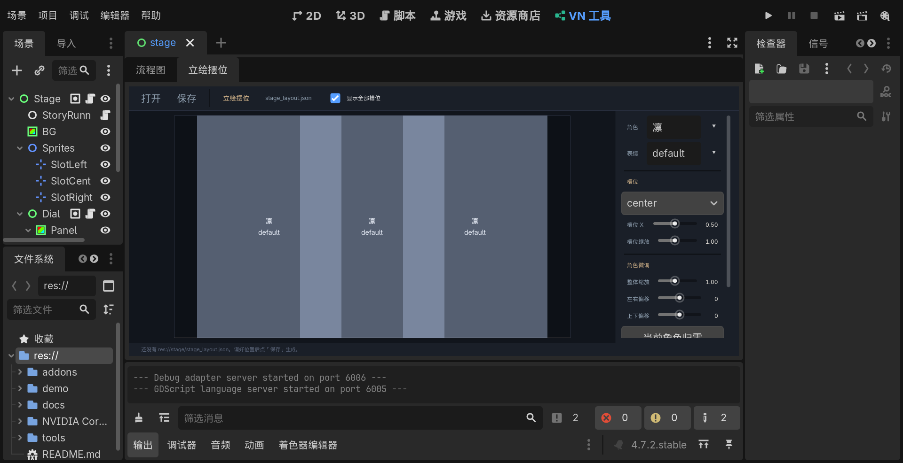

# 立绘摆位

第二个工具。解决的唯一问题：**立绘站在哪、多大、脚踩在哪条线上。**

它不是一个 UI 框架，也不是必须使用的舞台。它是 `vn_stage` 契约的**一个可选实现** + 一份可视化调参面板。不用它，自己写两个方法照样跑。



---

## 三样东西

| 产出 | 位置 | 是什么 |
|---|---|---|
| 数据 | `res://stage/stage_layout.json` | 槽位定义 + 每个角色的微调。手改、diff、迁移都方便 |
| 运行时节点 | `addons/vn/stage/sprite_stage.gd`（`VNSpriteStage`） | 可选。进 `vn_stage` 组，实现 `set_bg` / `set_sprite` |
| 编辑器面板 | 「VN 工具 → 立绘摆位」标签 | 拖一拖就出上面那份 JSON，不生成任何节点 |

**不带美术资源。** 一张图都不进 `addons/`，目录约定是 `res://art/chara/<角色>/<表情>.png`。

---

## 30 秒用法

1. 场景里放一个 `VNSpriteStage`（Control 派生），铺满你要的区域。
2. `layout_path` 指向 `res://stage/stage_layout.json`（面板保存时生成）。
3. 剧本里什么都不用改——它已经在 `vn_stage` 组里，`VNKit.sprite()` 会找到它。

不想用这个节点？把它删了，自己写：

```gdscript
extends Control
func _ready() -> void:
	add_to_group("vn_stage")
func set_sprite(who: String, pose: String, slot: String, fade: float) -> Signal:
	# 你的实现
	return get_tree().process_frame
```

---

## 目录约定

```
res://art/
├── chara/
│   ├── 凛/
│   │   ├── default.png
│   │   └── 平静.png
│   └── 葵/
│       └── default.png
└── bg/
    ├── 教室.png
    └── 夜晚.png
```

找图顺序：**请求的 pose → `default` → 占位色块**。所以「这个表情还没画」不会崩，也不会卡住剧情。

找不到图时：

- 生成一块按角色名取色的占位图（默认 700×1080），日志一条 `push_warning`
- 流程照常推进，`await` 的时间不变
- 这就是灰盒阶段的正常用法：先跑通流程和站位，图后补

**这是约定，不是注册表。** 没有导入流程、没有资源清单、没有必须登记的 id。

---

## `stage_layout.json`

```json
{
	"version": 1,
	"canvas": [1920, 1080],
	"placeholder": [700, 1080],
	"chara_dir": "res://art/chara",
	"bg_dir": "res://art/bg",
	"slots": {
		"left":   { "x": 0.24, "scale": 1.0 },
		"center": { "x": 0.5,  "scale": 1.0 },
		"right":  { "x": 0.76, "scale": 1.0 }
	},
	"characters": {
		"凛": { "offset": [0, -8], "scale": 0.92 }
	}
}
```

| 字段 | 含义 | 说明 |
|---|---|---|
| `canvas` | 参考画布尺寸 | 只影响占位图大小与面板预览比例；`x` 是比例量，换分辨率不用改 |
| `placeholder` | 缺图时占位色块尺寸 | 按 `canvas` 坐标 |
| `chara_dir` / `bg_dir` | 素材目录 | 改了这两个字段就能换目录结构 |
| `slots.<名>.x` | 槽位中心在画布宽度的比例 | 0 = 最左，1 = 最右 |
| `slots.<名>.scale` | 该槽位的整体缩放 | 三人并排时常用左右 0.9 / 中间 1.0 |
| `characters.<角色>.offset` | 这个角色的像素偏移 | 补画稿本身不居中的问题，存整数 |
| `characters.<角色>.scale` | 这个角色的整体缩放 | 和槽位 scale **相乘** |

最终尺寸 = `图尺寸 × 槽位 scale × 角色 scale`；最终位置 = 槽位 x（锚点）+ 角色 offset。

槽位可以自己加（`far_left` 之类），面板会读出来。未知槽位名在运行时回退到 `center` 并警告，不会让角色消失。

---

## 面板怎么用

顶栏：**打开 / 保存 / 显示全部槽位**。改过没存时按钮会变成 `保存 •`。

| 控件 | 作用 |
|---|---|
| 角色 / 表情 | 直接打字（可以是还没画的角色），或点 `▾` 扫描 `chara_dir` 里已有的 |
| 槽位 | 切换当前编辑的槽位；预览里三个都显示时，只有选中的那个受槽位参数影响 |
| 槽位 X / 槽位缩放 | 改的是**这个槽位**，所有角色共用 |
| 整体缩放 / 左右偏移 / 上下偏移 | 改的是**这个角色**，所有槽位共用 |
| 当前角色归零 | 偏移清零、缩放回 1.0 |
| 直接在画面上拖动立绘 | 等于改左右/上下偏移（按预览缩放换算，所见即所得） |

预览是 16:9 的缩小版画布，底部那条金线是「地面」：立绘的脚底永远贴在这条线上，`offset.y` 是把它抬高多少。

**面板和运行时用的是同一个几何函数**（`VNStageLayout.place()`），所以不存在「面板里对、进游戏偏了」。

面板只写 JSON，不碰场景、不创建节点。

---

## 运行时节点

```gdscript
@export_file("*.json") var layout_path := ""
@export var clip_sprites := true      # 超出画布要不要裁
@export var fallback_chara_dir := "res://art/chara"
```

| 注意 | 说明 |
|---|---|
| 它是 Control | 放在全屏拉伸的 Control / CanvasLayer 下。父节点不是 Control 时会自动铺满视口 |
| 自动进组 | `_ready()` 里 `add_to_group("vn_stage")`，不需要在场景里手动加 |
| 两个方法都有返回值 | `set_bg(id, fade)` / `set_sprite(who, pose, slot, fade)` 返回 `Tween.finished`，`await` 它拿到的就是「淡入真的走完」 |
| 换表情不重播淡入 | 已经在台上的角色只换图与站位，避免闪一下 |
| 背景两层交替 | 淡入淡出交叉，不会先黑一下 |
| 参数变了要重开游戏 | 面板保存后运行时读的是最新文件，但已经在跑的场景不会热更新 |

`id` 传法两种都行：`"教室"`（按 `bg_dir` 拼路径）或 `"res://art/bg/教室.png"`（完整路径）。

---

## 和契约的边界

| | 状态 |
|---|---|
| 新增组名 | **没有**。只实现已有的 `vn_stage` |
| 改已有方法签名 | **没有**。`set_bg` / `set_sprite` 一字未动 |
| 必须用它 | **不必**。加了 `vn_stage` 组、实现两个方法的任何节点都能顶替 |
| 删掉它 | 场景里那个节点失去脚本，删掉节点即可；项目仍是普通 Godot 游戏 |
| 新资源格式 | 没有。就是一份 JSON，删了插件用记事本也能看 |

---

## 常见问题

| 现象 | 原因 |
|---|---|
| 立绘偏左/偏右 | `canvas` 与实际输出分辨率不一致（它是比例基准，不是像素硬编码），或角色画稿本身没居中，用 offset 补 |
| 立绘太大/太小 | 槽位 scale × 角色 scale 都要看，两个相乘 |
| 换角色时闪一下 | 那个角色第一次出现，属于正常淡入 |
| 图明明在却不显示 | 检查大小写与目录层级：`chara/<角色>/<表情>.png`，表情名要和剧本里传的一字不差 |
| 面板里看不到素材 | `chara_dir` 指向的目录不存在；先建目录再点 `▾` |
| 保存后游戏里没变 | 面板写的是 JSON，运行中的场景不会热更新，重开一次 |

---

## 测试

```bash
GODOT=/path/to/godot

# 舞台：几何、存盘往返、Signal 时序、缺图降级、面板数据通路（39 项）
$GODOT --headless --path . --script res://tools/test_stage.gd

# 布局：两个标签面板在 8 种尺寸下都不塌
$GODOT --headless --path . --script res://tools/test_layout.gd
```

改过 `place()`、槽位算法或面板布局，这两个都必须跑。
